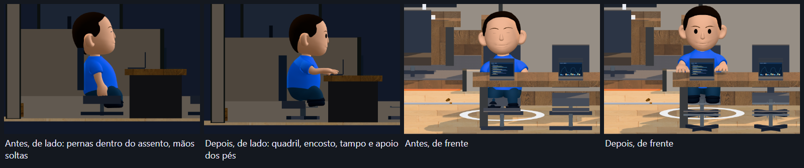
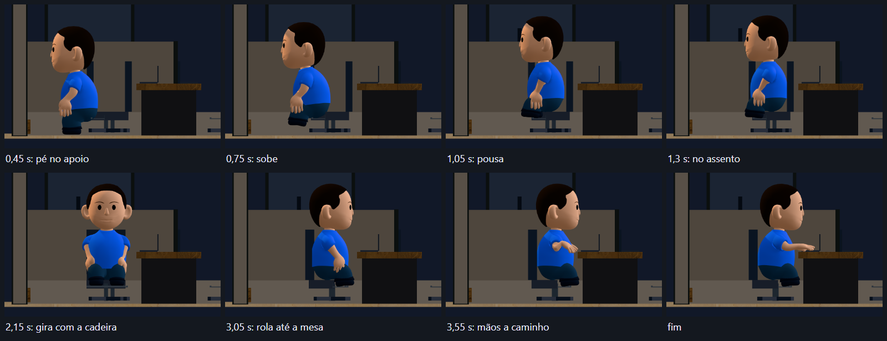
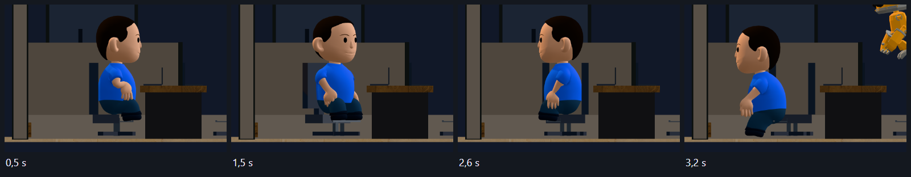
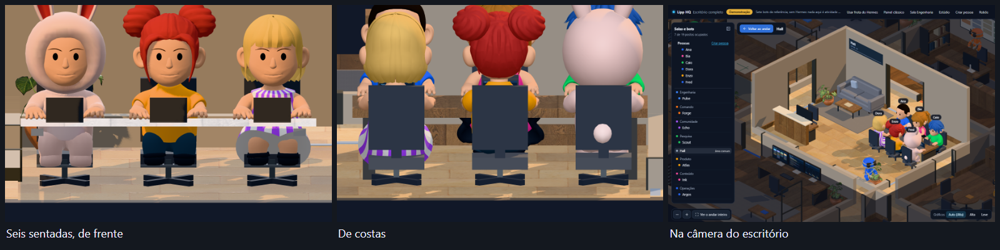

# Avatares: pessoas e robôs

Pessoas e bots são coisas diferentes neste projeto, e cada um tem o seu modelo:

| Quem    | Modelo                                                 | O que representa                              |
| ------- | ------------------------------------------------------ | --------------------------------------------- |
| Pessoa  | pacote de avatar do Wawa Sensei, montado peça por peça | gente criada no editor, em `/avatares.html`   |
| Bot     | RobotExpressive oficial do three.js                    | os agentes (demonstração e frota do Hermes)   |

## Origem e licença

### Pessoas: pacote do Wawa Sensei

- Autor: Wawa Sensei (`wass08`).
- Repositório: <https://github.com/wass08/r3f-ultimate-character-configurator>, commit
  `802398d1a195a36c270ab451d883c128044e3177`. Demo: <https://avatar.wawasensei.dev>.
- Fonte: `Assets.zip` da raiz do repositório, 43.745.609 bytes, SHA-256
  `455fc3bf5e31877d5e672e5c2d34557e82d2fd049be6cc6e65aed7f3ba6914ec`, e
  `public/models/Poses.glb`.
- **Licença: não identificada.** O repositório não tem arquivo de licença e a API do
  GitHub devolve `license: null`. Isto não é MIT nem nenhuma outra licença declarada.
- **Autorização de uso:** informada pelo Filipe Moreira em 2026-11-04 ("Já vi aqui tudo
  podemos usar, bora usar"). O registro é do que foi informado; quem for redistribuir
  este projeto fora daqui precisa reavaliar.
- **Onde aparece:** este registro fica aqui e em `public/avatares/proveniencia.json`. O rodapé do
  editor dá só o crédito ao autor e um link para `public/avatares/CREDITOS.md`, porque a situação
  da licença é assunto de quem mantém o projeto, não de quem está montando uma pessoa.

### Robôs: RobotExpressive

- Modelo de Tomás Laulhé (Quaternius), com modificações de Don McCurdy (três expressões
  por morph, conversão com FBX2GLTF, redução de metalicidade). Licença **CC0 1.0**.
- Origem: <https://github.com/mrdoob/three.js/tree/dev/examples/models/gltf/RobotExpressive>.
- `public/avatares/robo/README.md` é o README oficial, sem alterações, e o GLB é o
  arquivo oficial, byte a byte. O autor sugere considerar apoiar o Patreon dele.

SHA-256 de cada origem e o comando usado estão em `public/avatares/proveniencia.json`.
Para refazer tudo: `node scripts/avatar/prepare-assets.mjs`. O script só baixa, confere e
comprime; não executa nada do pacote.

## O que entrou do pacote

São 88 peças, em 15 categorias: cabeça, cabelo, olhos, sobrancelhas, nariz, rosto, barba,
óculos, chapéu, laço, brinco, blusa, calça, sapatos e fantasia. Depois do meshopt ocupam
5,5 MB (eram 27 MB); a geometria não foi simplificada.

Ficaram de fora, de propósito:

| Arquivo                             | Motivo                                                                |
| ----------------------------------- | --------------------------------------------------------------------- |
| `Outfit.002.glb`                    | fantasia amarela (material "Pika") que imita um personagem de franquia |
| `NakedFullBody.glb`                 | corpo sem roupa; o corpo já vem nas peças de roupa                     |
| `FaceMask.glb`                      | mesma máscara de `Face.007`                                            |
| `*.blend`, `*.fbx`, `*.jpg`, `*.png` | arquivos de trabalho do autor; nenhum é servido                        |
| `Teleporter Base.glb`               | cenário do demo original, sem uso aqui                                 |

As miniaturas do editor (`miniaturas/*.webp`) são fotos das próprias peças, tiradas por
`node scripts/avatar/thumbs.mjs <url do dev> public/avatares/humano/miniaturas`. Não há
arte nova.

## Como a pessoa é montada

O projeto original lê o catálogo de um PocketBase. Aqui ele é a tabela
`src/avatar/human/catalog.ts`, sem rede e sem credencial. Os testes conferem essa tabela
contra os arquivos: toda peça tem GLB e miniatura, e o que ela diz sobre cor é verdade.

- **Um esqueleto por pessoa.** As 88 peças têm os mesmos 75 ossos, na mesma ordem. Cada
  `HumanFigure` clona o esqueleto do `armature.glb` e liga todas as malhas a ele.
- **A compressão muda as matrizes.** O `meshopt` guarda cada peça em coordenadas próprias
  e compensa nas matrizes inversas *do arquivo daquela peça*. Como todas usam o esqueleto
  comum, a mesma compensação vai para a matriz de ligação (`quantizationOf`). Sem isso, a
  figura vira um punhado de pontas. Há teste para isso, osso por osso.
- **Nada de cor no cache.** Geometria e textura são divididas entre as figuras; materiais
  `Color_`, pele e morphs são de cada uma. Mudar a camisa de uma pessoa não muda a de outra.
- **Uma peça por categoria, e travas.** `locks` diz o que a peça cobre: a fantasia com
  capuz tira blusa, calça, sapatos, cabelo e chapéu; o vestido tira blusa e calça; a
  abóbora tira a cabeça inteira. A escolha coberta fica guardada para quando tirar.
- **Memória.** Quando nenhuma figura usa uma peça, a memória de GPU dela é devolvida. Ela
  segue na RAM da página, e o three a envia de novo se voltar.

As travas do original ficam no PocketBase, que não é público. As daqui foram definidas
vendo as peças; **não há detecção automática de colisão**. Cabelo muito volumoso sob
chapéu, por exemplo, ainda pode atravessar um pouco.

## Animações: o que existe de verdade

Inspecionei `Poses.glb`, `Armature.glb` e os `.blend` do pacote.

| Clipe                                                | De onde vem                                             | Tipo               |
| ---------------------------------------------------- | ------------------------------------------------------- | ------------------ |
| Em pé                                                | `Idle` do `Poses.glb` (8,37 s)                          | animação do pacote |
| Relaxada, Descolada, Dramática, Rei, Ninja, Ocupada, Soco | `Poses.glb` (um quadro cada)                            | foto parada        |
| Andando                                              | `Walking` do RobotExpressive, redirecionado             | retarget           |
| Sentada                                              | `seatedPose.ts`, contra as medidas do móvel             | pose calculada     |
| Levantar                                             | o `Sentada` de trás para a frente                       | pose calculada     |

**O pacote não tem andar nem sentar.** `retarget.ts` assa o andar quadro a quadro no esqueleto
do avatar: membros apontam para onde os da origem apontam (as poses de repouso são diferentes),
e bacia, coluna, cabeça e pés recebem a rotação da origem.

O sentar não vem de outra figura. `seatedPose.ts` tem os instantes da coreografia, escritos à
mão em metros do andar, e resolve pernas e braços por cinemática inversa, contra as medidas de
`seatFit.ts`, as mesmas que desenham a cadeira. Sai um clipe comum, como os outros. O `pulse.glb`
não é mais baixado para as pessoas.

Limites reais: o andar vem de um robô de pernas curtas, então lê como caminhada, mas sem a
qualidade de uma captura feita para esta figura. Os instantes do sentar são escritos à mão: dá
para ver que é animação de pose em pose, e isto não é captura de movimento.

## Persistência

`localStorage`, chave `hq.avatares.v1`. Só ids e cores. Dado corrompido vai para
`hq.avatares.backup` antes de qualquer gravação, versão futura nunca é sobrescrita e peça
que saiu do catálogo volta ao padrão sem apagar a pessoa.

## Verificação

- `pnpm test`: catálogo contra os arquivos, preset, persistência, figura, rotas e robôs.
- `pnpm qa:avatar`: o editor de pessoas no navegador (`HQ_URL` aponta para o servidor).
- `pnpm qa:pessoas`: do editor até sentar na bancada.
- `pnpm qa:assento`: fotos de corte e ossos lidos quadro a quadro, nos seis lugares.
  `scripts/visual-qa/office-seat-report.mjs` resume o que foi gravado.
- `pnpm qa:robos`: voo, clique, cor, expressão, movimento reduzido e fps.

## Pessoas no escritório

Quem é salvo no editor aparece no hall da demonstração (`/?escritorio=completo&modo=demonstracao`).
Salvar em outra aba já atualiza o escritório aberto.

- **Pessoa não é bot.** Fica em `humans` no store, separada de `bots`: não ocupa posto, não
  vem do Hermes, não tem sessão nem estado. No modo ao vivo nenhuma pessoa aparece, para não
  se misturar com a frota real.
- **O chefe.** Na demonstração há sempre uma pessoa a mais, o Chefe (`officeChief.ts`), sem precisar
  de editor. Ainda é igual às outras: o comportamento próprio dele está em discussão.
- **Só se mexe quando mandam.** O painel tem "Sentar na bancada" e "Levantar e voltar". Não
  há rotina própria, para não parecer que a pessoa está trabalhando. Parada, ela só toca o
  `Idle` e pisca.
- **Caminhos contra a mobília real.** `chairRoute` vem por trás da fileira. Os testes percorrem
  cada caminho contra os `footprints` que `buildOffice()` gera e contra os vértices vestidos.
  Pessoas não desviam umas das outras.
- **Movimento reduzido.** O comando vai direto ao fim, sem andar e sem piscar.
- **Capacidade.** Seis no hall, uma para cada cadeira da bancada. Além disso, a pessoa segue
  salva e listada, sem corpo na cena, porque cada uma soma de 30 a 100 mil triângulos, conforme a roupa.
- **Escala.** O arquivo tem 2,05 m, e metade é cabeça: no tamanho original ela cobria quem
  estava atrás. No escritório a pessoa fica com 1,48 m.

Limites reais: a sombra acompanha quem anda a cada 6 quadros.

### Sentar na bancada

A figura tem 90 cm de largura com os braços, e o vão entre duas cadeiras tem 38 cm. O assento antigo
ficava a 5,5 cm da mesa. Não existe caminho até uma cadeira parada, então a cadeira do hall se move
como uma de verdade (`HumanChairs.tsx`, `seatMoment`):

1. A pessoa vem por trás da fileira. Antes de ela chegar, a cadeira recua 9 cm e gira para ela.
2. Ela vira de costas para o assento e sobe: um pé no apoio, o impulso, a bacia no assento.
3. A cadeira gira meia volta com ela em cima, e depois rola até a mesa. Os pés ficam no apoio da
   própria cadeira, então nada escorrega no chão.
4. As mãos sobem, cruzam a borda acima do tampo e pousam ao lado do laptop.

Levantar é o mesmo tempo ao contrário, e a cadeira volta ao lugar quando ela já se afastou.
Caminho curto não dá tempo de a cadeira girar: a pessoa espera a cadeira começar, em vez de ser
atingida pelo encosto. Com movimento reduzido, tudo vai direto ao fim.

**A figura não cabe numa cadeira de escritório comum, e isso não se resolve só com a pose.**

| Medida da figura                        |   cm | Consequência                                                   |
| --------------------------------------- | ---- | -------------------------------------------------------------- |
| Perna inteira, do quadril ao chão       |   36 | assento a 33 cm: quem senta sobe, e os pés não alcançam o chão |
| Coxa                                    |   16 | num assento de 55 cm, a canela não teria para onde dobrar      |
| Braço, do ombro ao punho                |   25 | com a barriga de 27 cm, o punho para na borda da mesa          |

Por isso, a cadeira do hall tem o assento mais curto (33 cm de fundo), a base em X e uma barra de
apoio para os pés. Altura do assento, encosto e mesa não mudaram. As cadeiras das outras salas
continuam como eram: ninguém senta nelas.

Medido nos vértices vestidos, com a roupa padrão, contra as caixas do móvel:

| Contato                                                    | Antes                          | Agora           |
| ---------------------------------------------------------- | ------------------------------ | --------------- |
| Deslocamento de lado enquanto senta                        | 50 cm em 0,95 s                | 0               |
| Mãos em relação ao tampo (72 cm)                           | punhos a 17 e 26 cm abaixo dele | 1,0 e 0,1 cm acima |
| Pés                                                        | soltos, sem apoio              | 0 e 0,1 cm da barra |
| Quadril em relação ao assento                              | canelas e mãos dentro dele     | 0,2 cm dentro   |
| Costas em relação ao encosto                               | atravessavam                   | 0,6 cm dentro   |

Os seis lugares passam pelo mesmo teste, na ida e na volta (`tests/unit/humanSeat.test.ts`):
nenhum osso anda mais que 14 cm entre dois quadros, a bacia e os pés não saem do lugar em relação
à cadeira depois de pousar, e a roupa entra menos de 2 cm no assento e no encosto e menos de 1 cm
no tampo e nas cadeiras vizinhas. No navegador, os mesmos ossos foram lidos da cena, quadro a quadro
(`docs/avatares-evidencias/assento-depois-medidas.json`; o de antes está ao lado).

Limites reais, depois da correção:

- **Saia, vestido e rabo de fantasia atravessam.** Não há simulação de pano: as peças só seguem o
  esqueleto. Com `Bottom.003` e `WawaDress`, a saia entra 6 cm no assento e sobe 1,6 a 4 cm além
  da face de baixo da mesa. O rabo de `Outfit.003` entra 4 cm no encosto.
- **A cadeira se move sozinha.** Não há gesto de puxar: nenhuma mão encosta nela quando ela recua
  e gira, porque a pessoa ainda está longe.
- **A subida é um salto pequeno.** Com pernas de 36 cm, os dois pés deixam o chão por um instante,
  com o peso num pé só, sobre a barra. Ninguém simulou esse peso: a subida foi escrita pose a pose.
- **Os braços ficam quase esticados.** O punho para 1,5 cm antes da borda, e palma e dedos ficam
  sobre o tampo. A pessoa não digita: as mãos ficam ao lado do laptop.
- **Duas pessoas se cruzando não se enxergam.** A cadeira de quem está sentando pode passar por
  quem anda atrás da fileira, e duas pessoas podem se atravessar no caminho. Só foi medido uma de
  cada vez e com as seis já sentadas, não com as seis se movendo juntas.
- **Mão perto da parede.** Na fileira de trás, a faixa de passagem fica a cerca de 1 cm da parede
  norte, na mão mais aberta. É estimativa: o teste não mede a parede.
- **Sombra de contato.** A sombra suave do chão é feita uma vez, com as cadeiras no lugar. Só o mapa
  de sombra do sol acompanha a cadeira afastada.

## Robôs no escritório

Cada bot é um RobotExpressive, com o nome, a sala, a etiqueta, o painel e o estado que já
tinha. A figura sentada do Pulse saiu do escritório; o `pulse.glb` segue no estúdio de
personagens.

- **Voo só na demonstração.** Na frota real o robô flutua no posto e não sai dali: um voo
  pareceria dizer algo sobre o que o bot está fazendo. O estado continua vindo do Hermes, no
  ponto da etiqueta. Na demonstração, o painel diz que o voo é só desenho.
- **Rotas contra a planta real.** `officeFlights.ts` faz uma busca A* numa grade de 10 cm a
  partir dos `footprints` de `buildOffice()`, das plantas e das paredes. O robô só usa a
  própria sala, as portas dela e os corredores: nunca outra sala, nem o hall, onde as pessoas
  ficam. Bot sem caminho flutua no posto em vez de atravessar algo. Voando baixo, ele contorna
  todos os móveis, cadeiras inclusive.
- **Altura.** O pé fica entre 8 e 16 cm do chão: mais alto, o robô parecia estar em cima dos
  móveis. Por isso os postos de departamento não têm cadeira. Na bancada e na reunião, que só
  recebem robô com a frota cheia, a cadeira continua lá e ele fica acima do encosto (1,08 m).
- **Determinístico.** A posição é função do instante: sem sorteio nem relógio do sistema. Os
  testes conferem também que dois robôs nunca chegam a menos de 75 cm no chão.
- **Clique.** O robô selecionado acena uma vez e volta ao posto pelo mesmo caminho. Ao soltar,
  espera o voo agendado alcançá-lo, em vez de saltar até onde estaria. O aceno responde a quem
  clicou e não diz nada sobre o bot.
- **Pernas.** No arquivo, os pés são alvos de IK presos à raiz. `hangLegs` dobra coxa e canela
  e leva o pé até o fim da canela, numa pose de quem está no ar. O modelo não é alterado.
- **Cor e expressão.** Em `/avatares.html?aba=robos`, gravadas em `hq.robos.v1`. O padrão do
  corpo é a cor do bot, e dado inválido volta ao padrão. Os clipes do arquivo têm trilha dos
  três morphs e apagariam a expressão, então essas trilhas são filtradas. Corpo e morphs são
  de cada robô, e o cache do arquivo não muda. A expressão é só aparência: não vem do estado.
- **Movimento reduzido.** Todos parados no posto, sem flutuar e sem gesto.
- **Sombra.** O robô não projeta sombra do sol, que mudaria aos saltos a cada refazer do mapa.
  Uma marca no chão mostra onde ele está.

Limites reais: o voo é um passeio de ida e volta, e nenhum robô desvia de outro em tempo real
(a separação vem do horário). Em bot com posto extra, na frota real, o voo não existe.
`OfficeBot.spec` e `specForBot` ficaram sem uso no escritório e continuam lá, com os testes
deles, para não misturar limpeza nesta entrega.

## Custo medido

Windows, RTX 3070, Chromium com D3D11, 1440 × 900, qualidade alta:

| Cena                                         | fps | Chamadas de desenho | Triângulos por quadro |
| -------------------------------------------- | --- | ------------------- | --------------------- |
| Sete robôs, sem pessoas                      | 60  | 157                 | 447 mil               |
| Sete robôs e seis pessoas, roupa mais pesada | 60  | 235 a 301           | 1 a 2 milhões         |

Os 60 fps são o limite da tela nesse teste, não a folga da placa. A segunda linha é o pior
caso, e o maior número é o do quadro que refaz o mapa de sombra. Cada linha é uma leitura de
um quadro, e não foi medido em máquina mais fraca; nela, o modo automático cai para a
qualidade leve se não segurar cerca de 38 fps.

O `office.mjs` não roda direto no Windows: usa `--use-angle=metal` e o `.bin/vite` de Unix.
Foi rodado com esses dois pontos trocados numa cópia temporária. A cópia não foi commitada.
